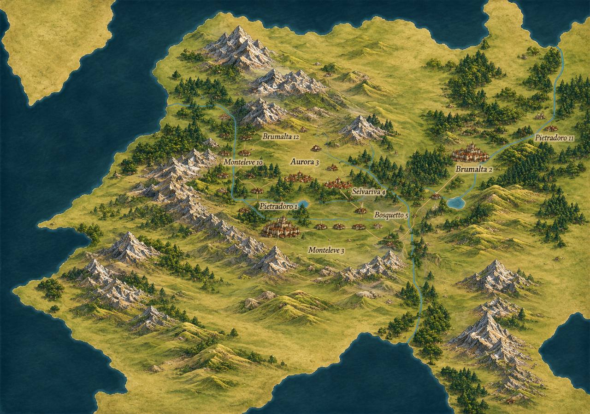

# Drakelya Maps — brief pubblico per asset 2D

Materiale autonomo per l'AI grafica esterna: istruzioni, reference e sorgenti selezionate per il primo lotto pilota. Questo repository non contiene il codice del progetto né nuovi master già prodotti.

**[AI esterna: inizia da START_HERE.md](START_HERE.md)**

Link di testo diretto da passare all'AI: [START_HERE raw](https://raw.githubusercontent.com/Maxilboss93/DrakelyaMaps-Asset-Brief/main/START_HERE.md).

## Consegna

- Prima fase: due campioni di stile, massiccio e sella. Fermarsi per revisione.
- Lotto completo:15 PNG (12 adattamenti,3 nuovi), da completare dopo revisione dei due campioni.
- [Brief completo](asset-pilota-01/BRIEF_COMPLETO_AI_ESTERNA.md), [distinta](asset-pilota-01/02_DISTINTA_15_FILE.md), [regole di restituzione](asset-pilota-01/03_CONSEGNA_E_QA.md).
- [Pacchetto leggero dei primi due campioni, ZIP4.5MB](https://raw.githubusercontent.com/Maxilboss93/DrakelyaMaps-Asset-Brief/main/downloads/AI_ESTERNA_PRIMI_DUE_CAMPIONI.zip).
- [Scarica tutto il repository in ZIP](https://github.com/Maxilboss93/DrakelyaMaps-Asset-Brief/archive/refs/heads/main.zip).

## Obiettivo

Suolo ocra/oliva articolato, rilievi e colline pittorici, margini boschivi variati e raccordi coerenti con il terreno. Usare la reference come direzione stilistica; non ritagliarla in sprite da rivendere.

## Contenuto e provenienza

La cartella asset-pilota-01 contiene il pacchetto consegnato il14 novembre2026:15 prompt,22 copie sorgente non modificate,15 documenti visivi di riferimento e schede tecniche. La mappa delle sorgenti e i manifest registrano percorsi, dimensioni e SHA-256. Il confronto mostra target e risultato attuale su geografie diverse; il risultato attuale non è approvato artisticamente.

Gli ID ART-* sono nomi di commessa. I contratti sono proposte di authoring e non campi già letti dal motore. Nessun risultato d'integrazione o prestazione è dichiarato.

La pubblicazione non assegna una licenza libera agli artwork: conservare i termini e la provenienza effettivi. Non attribuire CC0, MIT o altre autorizzazioni per inferenza.
